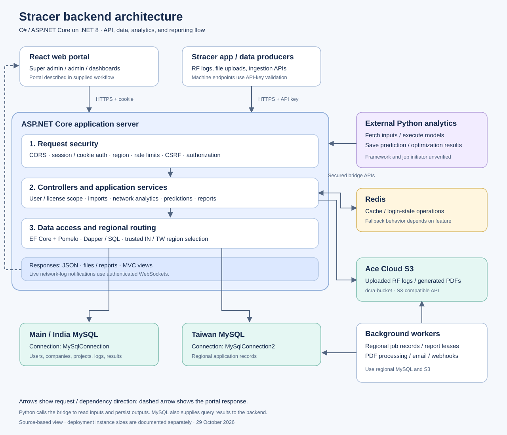
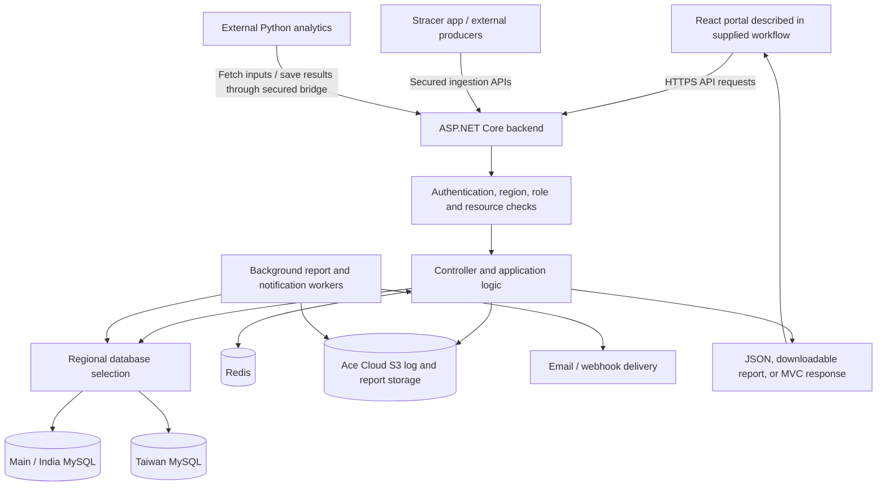
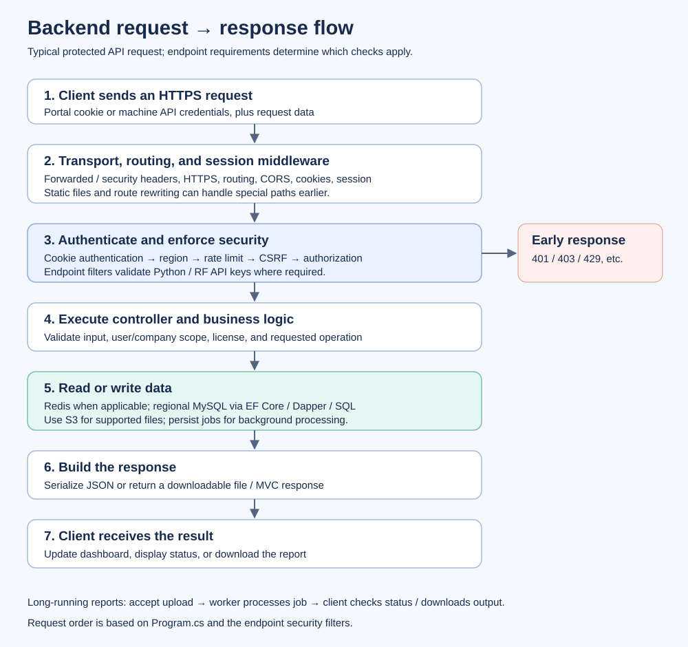

# Stracer backend framework, libraries, and workflow

Based on the repository inspected on 29 October 2026 and the supplied `Stracer_Work_flow.txt`. The text file provides deployment context; the implementation details below come from the C# source. Server instance sizes and the external Python implementation have not been verified against a running deployment.

## 1. Backend technology

Stracer's main backend is written in **C# using ASP.NET Core on .NET 8**. It uses MVC controllers to expose JSON APIs and support Razor views. It runs through ASP.NET Core's Kestrel web server, with dependency injection configured in `Program.cs`.

The project has controllers, services, DTOs, models, middleware, and security helpers. Database access uses Entity Framework Core, Dapper, and direct SQL commands. Some controllers access the database directly, so the implementation does not enforce a separate repository layer for every operation.

| Component | Implementation |
| --- | --- |
| Backend framework | ASP.NET Core MVC / HTTP APIs |
| Target runtime | .NET 8 (`net8.0`) |
| Language | C# |
| Relational database | MySQL; EF configuration specifies MySQL server version 8.0.29 |
| ORM | Entity Framework Core 9.0.0 with Pomelo MySQL provider 9.0.0 |
| Additional database access | Dapper, MySqlConnector, ADO.NET commands |
| Browser authentication | Cookie authentication, claims, and server-side session |
| Cache and login state | Redis plus application fallback paths |
| External analytics integration | Secured Python bridge HTTP APIs |
| Live updates | ASP.NET Core WebSockets |
| Object storage integration | Ace Cloud S3-compatible storage (`dcra-bucket`) |
| API documentation | Swagger / OpenAPI in development |
| Container packaging | Multi-stage Docker build using .NET 8 images |

The EF Core package version and .NET target version are separate settings: this project targets .NET 8 while referencing EF Core 9 packages.

## 2. Backend libraries

These are direct package references in `SignalTracker.csproj`. A package reference establishes that the dependency is declared; it does not establish that every endpoint uses it.

| Library | Declared version | Role |
| --- | --- | --- |
| Microsoft.EntityFrameworkCore | 9.0.0 | Entity queries, tracking, and persistence through `ApplicationDbContext` |
| Microsoft.EntityFrameworkCore.Relational | 9.0.0 | Relational database support |
| Pomelo.EntityFrameworkCore.MySql | 9.0.0 | MySQL provider for EF Core |
| Pomelo.EntityFrameworkCore.MySql.NetTopologySuite | 9.0.0 | Declared spatial provider extension; startup shown here does not explicitly enable `UseNetTopologySuite` |
| Dapper | 2.1.66 | SQL mapping in RF upload, email, and database setup code |
| StackExchange.Redis | 2.10.1 | Redis connections and cache/login-state operations |
| Microsoft.Extensions.Caching.StackExchangeRedis | 9.0.10 | Declared distributed Redis cache integration; direct Redis operations use `RedisService` |
| BCrypt.Net-Next | 4.0.3 | Password hashing and verification |
| CsvHelper | 33.1.0 | CSV parsing in import and validation paths |
| ExcelDataReader | 3.7.0 | Declared Excel reading dependency |
| ExcelDataReader.DataSet | 3.7.0 | Declared DataSet support for Excel reading |
| SixLabors.ImageSharp | 3.1.11 | Image handling in report generation |
| SkiaSharp | 2.88.8 | Graphics/chart rendering in report code |
| SkiaSharp.NativeAssets.Linux.NoDependencies | 2.88.8 | Native Linux graphics assets |
| SkiaSharp.NativeAssets.Win32 | 2.88.8 | Native Windows graphics assets |
| NetTopologySuite | 2.6.0 | Spatial geometry dependency |
| System.Text.Json | 10.0.8 | JSON serialization |
| Newtonsoft.Json | 13.0.3 | Additional JSON support |
| AWSSDK.S3 | 4.0.104.6 | S3-compatible client for RF logs and reports stored in Ace Cloud; the SDK name does not identify the storage provider |
| MailKit | 4.18.2 | SMTP delivery for RF report emails |
| Swashbuckle.AspNetCore | 6.6.2 | Swagger/OpenAPI generation |
| BuildBundlerMinifier | 3.2.449 | Static asset build tooling |
| Microsoft.Bcl.AsyncInterfaces | 7.0.0 | Async interface compatibility dependency |
| EntityFramework | 6.5.1 | Additional declared EF6 dependency; the active application context uses EF Core |
| MySql.Data | 6.10.9 | Additional declared MySQL driver; inspected current SQL paths use MySqlConnector |

`MySqlConnector` is used in the source but is not a direct package reference in this project file; it is supplied through the dependency graph. Cookie authentication, authorization, sessions, rate limiting, dependency injection, hosted services, WebSockets, and `HttpClient` use the ASP.NET Core/.NET platform APIs.

## 3. Overall system flow



[Open the architecture diagram](backend-architecture.svg). The editable Mermaid version follows.



The supplied deployment drawing identifies an application server (`m6a.xlarge`), Python analytics server (`t3.medium`), database server (`db.m5.xlarge`), and Stracer app server (`t3.medium`). These are deployment descriptions from that document, not settings confirmed by this repository.

The drawing also shows the app pushing data toward the database. The repository additionally implements app-to-backend ingestion APIs. The deployed app's exact ingestion route requires checking its implementation and deployment configuration.

## 4. Startup flow

1. `Program.cs` creates the web application builder and loads configuration. Development also explicitly loads the local `SignalTracker.LocalDevelopment` user-secrets file.
2. Registers application services for user scope, licenses, uploads, network logs, predictions, OTP, SMS, and RF integrations.
3. Registers hosted workers for report processing, report email, webhook notifications, and network-log changes. User-deletion cleanup is conditional.
4. Configures MVC, JSON serialization, Swagger, rate-limit policies, CORS, cookies, session, data protection, and HTTPS/proxy handling.
5. Registers the scoped database connection provider and EF Core context. The database is selected when a context is resolved for its scope.
6. Configures Redis or available fallback services, upload storage directories, and request-size limits.
7. Builds the middleware pipeline, maps controller endpoints, and starts serving requests.

Development startup schema changes run only when explicitly enabled by configuration. RF database checking/migration and storage checking also have explicit command-line modes.

## 5. Normal API request flow



[Open the request flow diagram](backend-request-flow.svg).

```text
Client HTTP request
  -> Forwarded headers and security headers
  -> Environment-specific error handling / HSTS / HTTPS
  -> Static files and legacy route rewrite, where applicable
  -> Routing and CORS
  -> WebSocket and cookie support
  -> Session availability handling and session loading
  -> Session activity pulse
  -> Cookie authentication
  -> Region access validation
  -> Endpoint rate limiting
  -> CSRF validation
  -> Authorization and partitioned-cookie support
  -> Controller action and endpoint-specific security filters
  -> Business logic, cache, database, or storage operations
  -> Response to client
```

Middleware and filters may reject or complete a request before it reaches a controller. Browser, RF ingestion, and Python bridge endpoints apply different authentication requirements.

## 6. Login and regional database flow

1. The portal calls `POST /api/auth/login` with email and password, optionally including country and force-login settings.
2. For an explicit `TW` login, authentication searches Taiwan first. Otherwise it checks the main database and can fall back to Taiwan. Main-database users marked Taiwan may also be resolved against Taiwan.
3. `PasswordSecurity` verifies credentials. BCrypt is the current hashing mechanism; successful legacy logins can upgrade older password representations.
4. The backend checks whether the portal license is active.
5. Login-lock handling prevents conflicting active logins and supports the explicit force-login path. The implementation uses `LoginLockFallbackService` with Redis integration.
6. The backend issues an authentication cookie containing signed identity claims, including user, company, user type, and the resolved country. It also populates server-side session values.
7. Subsequent requests authenticate the cookie and validate session/login state.
8. `DbConnectionProvider` selects `MySqlConnection` for the main/India database or `MySqlConnection2` for Taiwan.

Ordinary authenticated users are bound to the country in their trusted claims. They cannot switch regions merely by changing a query parameter. Privileged and machine API flows have explicit region-selection paths. Some authentication and super-admin user-management paths remain pinned to the main database.

## 7. Upload, processing, and dashboard flow

```text
Authorized file upload
  -> Validate access, file input, and configured limits
  -> Store file or assemble uploaded chunks, depending on endpoint
  -> Parse CSV / ZIP content through the relevant import path
  -> Validate and map records
  -> Persist records in the selected regional MySQL database
  -> Update relevant cache/version state
  -> Dashboard and map APIs query data using user/company scope
  -> Return filtered analytics to the portal
```

Relevant code includes `ExcelUploadController`, `ProcessCSVController`, `ZipImportService`, `NetworkLogDataService`, and `MapViewController`. Upload mechanics differ by endpoint; this is their shared conceptual flow.

Redis accelerates supported reads and provides coordination/state functions. Some cache paths can fall back to database reads. Login/session availability follows its own checks, so Redis failure should not be described as harmless for every feature.

Live network-log updates use `NetworkLogChangeWatcherService`, `NetworkLogRealtimeNotifier`, and the authenticated `/ws/network-log` WebSocket endpoint.

## 8. Python analytics flow

The repository confirms a **Python-to-.NET bridge** at `/api/PythonBridge/...`:

1. An external Python process requests required data, such as drive-test rows, L3 logs, projects, regions, or thresholds.
2. Bridge authorization checks `X-Python-Bridge-Key` or `X-API-Key` against configured credentials. There is a development loopback exception when no key is configured.
3. `PythonBridgeService` reads inputs from the relevant MySQL database and returns structured data.
4. The external process performs analytics/model execution outside this C# application.
5. It sends outputs back through endpoints such as `SavePredictionData`, `SaveLtePredictionResults`, or `SaveRfOptimizationResults`.
6. The backend persists results, which portal APIs can subsequently expose.

The workflow document describes the backend invoking a Python service. The bridge implementation alone does not establish which component initiates every analytics job. This repository does not establish the external service's framework or ML libraries; FastAPI, Flask, NumPy, Pandas, and model packages should only be documented after inspecting that service.

## 9. RF log and automatic report flow

```text
App / external uploader
  -> RF API-key validation
  -> Upload and completion APIs
  -> S3 object plus regional upload/job records
  -> Background worker claims pending job
  -> Download accepted ZIP and generate PDF
  -> Import supported Wi-Fi plot data
  -> Upload report to S3 and record completion/failure
  -> Email / webhook workers process configured delivery
  -> Client checks status and retrieves the report
```

The report worker processes India and Taiwan queues independently, renews its job lease, and avoids publishing results after losing ownership. This automatic PDF path uses backend services; it does not require assuming every report runs through Python.

## 10. Code reference map

| Area | Primary source files |
| --- | --- |
| Runtime, registration, request order | `Program.cs`, `SignalTracker.csproj` |
| Cookie/session configuration | `Configuration/SecurityServiceExtensions.cs`, `Security/SessionSecurity.cs` |
| Authentication | `Controllers/AuthController.cs`, `Security/PasswordSecurity.cs` |
| Database model and routing | `Models/AppDbContext.cs`, `Services/DbConnectionProvider.cs` |
| Region validation | `Middleware/RegionAccessMiddleware.cs`, `Security/RegionAccess.cs` |
| Resource access and licenses | `Security/ResourceAccess.cs`, `Services/UserScopeService.cs`, `Services/LicenseFeatureService.cs` |
| Cache | `Models/RedisService.cs`, `Services/VersionedNetworkLogCache.cs` |
| Python integration | `Controllers/PythonBridgeController.cs`, `Services/PythonBridgeService.cs`, `Security/PythonBridgeAuthorizeAttribute.cs` |
| RF logs and reports | `Controllers/RfLogIntegrationController.cs`, `Services/RfLogReportWorker.cs`, `Services/RfLogS3Storage.cs` |
| Deployment packaging | `Dockerfile` |

This is a source-based architecture description. It does not certify the live deployment, dependency compatibility, or runtime health. No secret values are needed for this document.

## 11. Backend deployment process


See the [complete deployment and testing runbook](backend-deployment-testing.md) for commands, IIS prerequisites, the Docker alternative, production configuration, regional migrations, health checks, and rollback steps.

## 12. Backend testing process


The [testing stages and supported regression commands](backend-deployment-testing.md#4-testing-process-diagram) distinguish existing checks from staging and production validation still required. These diagrams describe the process; they do not indicate tests have passed or the application has been deployed.
