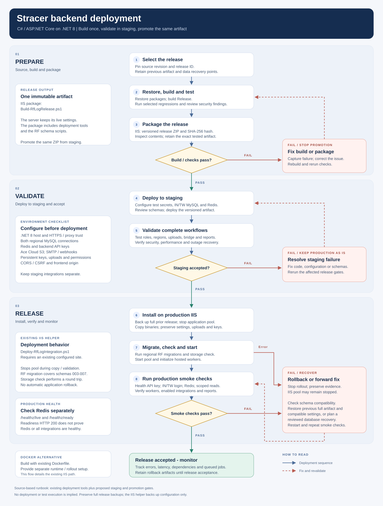
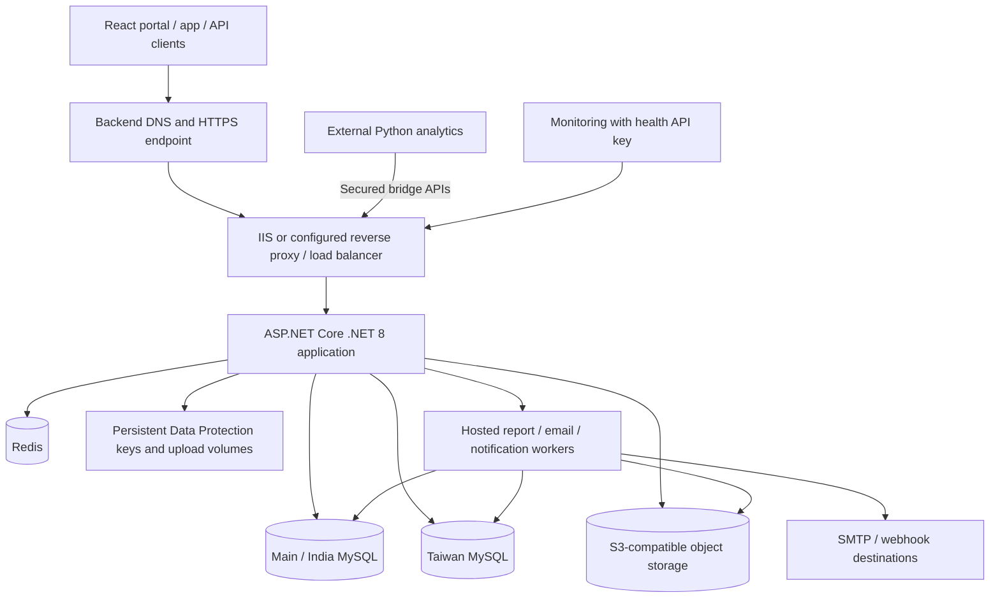
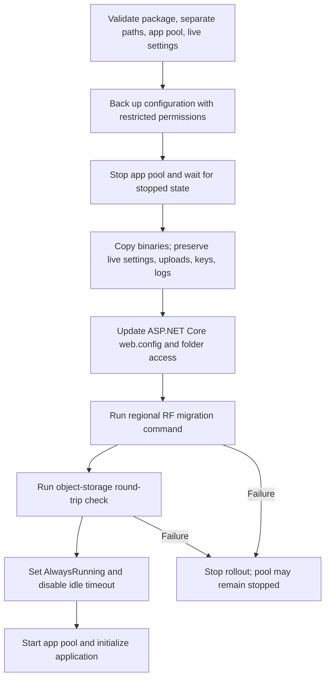
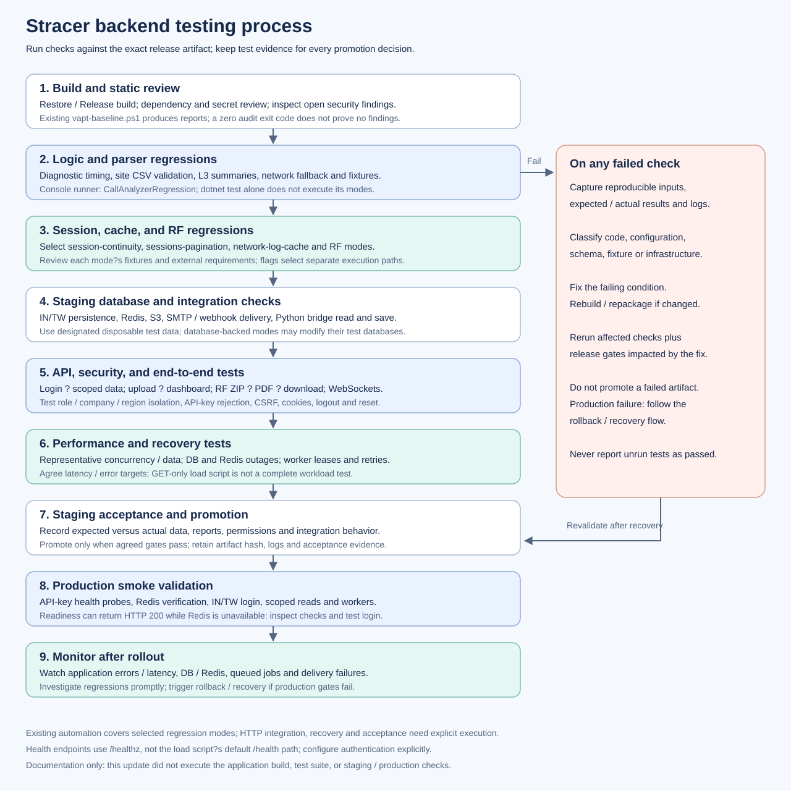
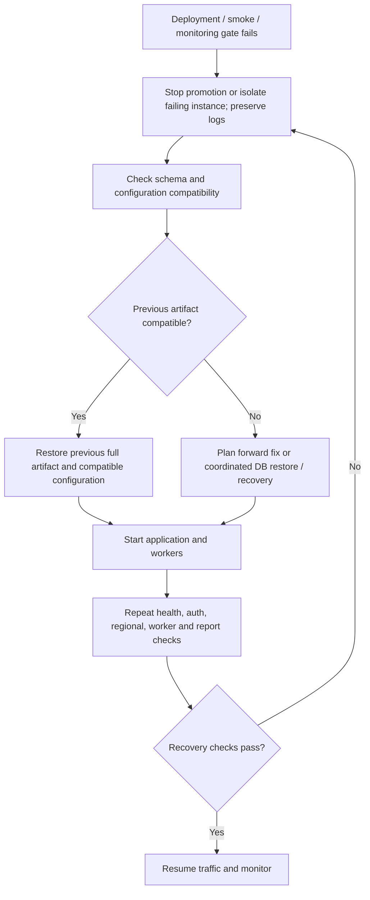

# Backend deployment and testing flow

This runbook describes the repository's existing deployment tools and a proposed release process around them. The diagrams are documentation, not evidence of a completed deployment or passing tests. Production infrastructure and credentials were not accessed. Read alongside [backend architecture](backend-architecture-flow.md) and [existing security deployment gates](security/DEPLOYMENT.md).

## Deployment process diagram



[Open full-size deployment diagram](backend-deployment-flow.svg) | [PNG version for sharing](backend-deployment-flow.png).

The diagram follows three phases: **Prepare**, **Validate**, and **Release**. Decision gates show when to proceed, fix and retest, or recover the previous release. The main path documents the existing IIS deployment; Docker is shown as a separate hosting alternative.

## Deployment topology



IIS is the target of `scripts/Deploy-RfLogIntegration.ps1`. Docker is an alternative packaging/runtime route provided by `Dockerfile`; the repository does not establish an automated production container rollout. The Python service is deployed separately, and its deployment steps cannot be confirmed from this C# repository.

## 1. Prepare a release

1. Select the exact source revision and record a release identifier.
2. Restore packages, build Release, and run the relevant regression modes.
3. Review dependency findings and the repository's open security/deployment gates.
4. Build one immutable release artifact. Deploy that same artifact to staging, then production after acceptance.
5. Record the package hash, configuration/schema requirements, test evidence, and previous working version.

Run from the repository root:

```powershell
dotnet restore SignalTracker.csproj
dotnet build SignalTracker.csproj -c Release --no-restore
dotnet build CallAnalyzerRegression/CallAnalyzerRegression.csproj -c Release
dotnet run --project CallAnalyzerRegression/CallAnalyzerRegression.csproj -c Release --no-build -- --security-baseline docs/security/endpoint-inventory.csv
dotnet run --project CallAnalyzerRegression/CallAnalyzerRegression.csproj -c Release --no-build -- --diagnostic-time-index
dotnet run --project CallAnalyzerRegression/CallAnalyzerRegression.csproj -c Release --no-build -- --site-csv Template-Files/Site_Template.csv
```

The regression project is a console application. Use its supported arguments with `dotnet run` or run the compiled DLL; `dotnet test` alone does not execute these checks. Select additional modes from the testing table below. The default runner expects ZIP datasets, with developer-specific fallback paths, so supply explicit fixture paths when using its default mode.

### Existing IIS release package

```powershell
./scripts/Build-RfLogRelease.ps1 -ReleaseName stracer-release-20261029-01
```

Choose a new release name each time. This script publishes the backend, removes published `appsettings*.json`, bundles RF deployment/configuration scripts and SQL, creates a ZIP under `artifacts`, and prints a SHA-256 hash. It uses `--no-restore`, so restore first. Inspect the resulting package for unintended local data before distribution.

### Docker alternative

```powershell
docker build -t signaltracker:release-20261029-01 .
```

The existing multi-stage Dockerfile restores and publishes with the .NET 8 SDK, then runs `SignalTracker.dll` on the .NET 8 ASP.NET runtime image. Before using it for deployment, review the build context and packaged files, supply production configuration at runtime, set the container's listen address/port, and mount persistent keys/uploads where required. Configure HTTPS termination, trusted proxy addresses, restart behavior, logs, and monitoring in the hosting platform. Run explicit schema checks/migrations as a release step. No container orchestration, registry push, or automatic rollback is supplied by this Dockerfile.

## 2. Prepare staging and production hosts

| Area | Required preparation |
| --- | --- |
| IIS host | .NET 8 Hosting Bundle, IIS site/app pool, HTTPS certificate/binding, correct process identity |
| Container host | Container runtime/platform, image distribution, HTTPS proxy, explicit runtime configuration and persistent mounts |
| Network | Backend can reach both MySQL databases, Redis, object storage, and configured delivery services |
| Databases | Backups and restore procedure; schema compatibility checked for both regions |
| Configuration | Real production configuration from server settings/environment/secret storage |
| Filesystem | Writable upload/temp/log directories and persistent Data Protection keys with service-identity permissions |
| Workers | Process remains running; IIS idle timeout/preload behavior verified |

`appsettings.Production.example.json` is a reference file and is not loaded automatically. Local .NET User Secrets are a development mechanism. Set `ASPNETCORE_ENVIRONMENT=Production` for the hosted application and supply these settings through the actual deployment environment:

| Configuration group | Values to provide / verify |
| --- | --- |
| Regional data | `ConnectionStrings__MySqlConnection`, `ConnectionStrings__MySqlConnection2` |
| Redis | `ConnectionStrings__Redis`; validate real login/session behavior |
| Bridge / health | `PythonBridge__ApiKey`, `Security__PublicApiKey` |
| Browser security | `Security__AllowedOrigins__0` and further indexed origins, trusted forwarded proxies/networks, `Security__RequireCsrfHeader=true` |
| Persistent keys | `DATAPROTECTION_KEYS_PATH` or `DataProtection__KeysPath` |
| Feature integrations | RF storage/API keys, SMTP/email, SMS, webhook destinations as enabled |

See the existing production example and configuration scripts for feature-specific setting names. Keep staging credentials and test destinations separate from production.

## 3. Apply schemas and deploy on IIS

Before stopping the live app, preserve the **complete previous application artifact**, configuration, and required data backups. The deployment helper only backs up live `web.config` and `appsettings*.json`; it does not create a complete application or database rollback snapshot.

For an existing configured IIS installation, use the packaged script with actual server paths and app-pool name:

```powershell
# Example placeholders: replace these values for the target server.
./scripts/Deploy-RfLogIntegration.ps1 -PackagePath 'C:\Releases\stracer-release-20261029-01\backend' -BackendPath 'C:\Sites\SignalTracker' -AppPoolName 'SignalTracker'
```

`PackagePath` points to the extracted **backend directory containing `SignalTracker.dll`**, not the outer release directory. The script expects an existing IIS application pool and live `appsettings.json`. It is not a first-install provisioning script.

The script performs this sequence:



The RF migration command provisions the RF schemas embedded from migrations 003–005; do not assume it applies every migration in `Database/Migrations`. Review whether migrations 001/002 or other schema changes are prerequisites for the selected release. Production startup schema maintenance is not a general migration strategy.

Available application CLI checks, run from the deployed backend folder with the intended configuration available:

```powershell
dotnet SignalTracker.dll --rf-log-db-check --environment Production
dotnet SignalTracker.dll --rf-log-db-migrate --environment Production
dotnet SignalTracker.dll --rf-log-storage-check --environment Production
```

The migration command changes databases. The storage check performs a storage round trip; treat it as an integration check, not a read-only probe. The IIS deployment helper already runs migration and storage checking, so do not repeat them unnecessarily. CLI processes must receive the same effective configuration as IIS; the helper imports configured IIS environment values for its subprocesses.

The IIS helper stops the app pool during copying and validation, so plan for a maintenance window. It does not implement zero-downtime deployment or automatic rollback. Enable and verify IIS application initialization/preload if workers must start without a browser request.

## 4. Testing process diagram



[Open full-size testing diagram](backend-testing-flow.svg).

| Test stage | What to verify | Repository support / evidence |
| --- | --- | --- |
| Build and dependency review | Release compilation, dependency findings, no leaked credentials/artifacts | `dotnet build`, `scripts/vapt-baseline.ps1`; review its reports, not only exit codes |
| Logic / parser regressions | Diagnostic timing, CSV validation, L3 summaries, network fallback | Runner modes `--diagnostic-time-index`, `--site-csv`, `--l3-report`, `--network-fallback` |
| Session and cache regressions | Cookie/session continuity, pagination, cache behavior | `--session-continuity`, `--sessions-pagination`, `--network-log-cache` |
| RF integration regressions | Upload/report state behavior and configured integrations | `--rf-log-integration`; inspect fixture/environment needs before running |
| Database-backed regressions | Wi-Fi and email persistence against disposable staging data | `--wifi-plot-db`, `--rf-log-email-db`, `--rf-log-company-email-db`; inspect their connection/fixture requirements first |
| API and regional isolation | IN/TW login, overlapping IDs, role/company boundaries, rejected cross-region access | Real HTTP requests against staging with seeded accounts |
| End-to-end workflow | Upload → DB → dashboard; bridge read/save → result; RF upload → report → download | Staging API flows and expected row/report assertions |
| Security | Cookies, logout/reset invalidation, CORS/CSRF, API keys, unauthorized requests | `--security-baseline` plus authenticated HTTP tests and the existing security gates |
| Resilience | Redis/DB/storage outages, worker lease/retry, restart recovery | Controlled staging failures; verify recovery and no duplicate/stale output |
| Performance | Agreed latency/error targets, realistic datasets/concurrency, DB/CPU/memory behavior | `Tools/loadtest/LoadTest.ps1` supports basic concurrent GETs; more complete workload testing is still needed |
| Acceptance | Admin/user portal, regional data correctness, reports and notifications | Recorded stakeholder acceptance for the exact artifact |
| Production smoke | Health, real login, scoped read, bridge access, workers and enabled integrations | Time-stamped deployment evidence and monitored results |

Each runner flag selects a separate mode; the listed commands do not imply a single comprehensive automated suite. Review mode-specific fixtures and external service requirements before execution. Database-backed tests belong on disposable or designated test databases.

The existing load script defaults to `/health/ready`, but the implemented route is **`/healthz/ready`**. Pass a correct explicit URL. It supports cookie/bearer inputs but no dedicated API-key header argument; do not assume it can authenticate the protected health endpoint unchanged. Use an authenticated staging GET endpoint it can exercise, or extend the harness to send the required header. Health-only load tests do not represent import/report workloads. Set measurable acceptance thresholds before a load run.

## 5. Production smoke test and monitoring

1. Request `/healthz/live` and `/healthz/ready` with `X-Public-Api-Key` using the configured health key.
2. Inspect each dependency result, not just HTTP status. Current readiness checks the default-context database and Taiwan database, but **Redis status does not contribute to its overall HTTP success decision**. Verify Redis and actual production login/protected-request behavior separately.
3. Verify HTTPS forwarding and cookie attributes with the real frontend origin; sign in using designated IN and TW test users and verify their data scopes.
4. Check a representative dashboard read, API-key denial/acceptance, enabled bridge flow, report status/download, WebSocket connection, and worker startup.
5. Monitor HTTP errors and latency, database connections/latency, Redis availability, process restarts, queued/failed jobs, storage failures, and email/webhook failures. Existing health probes do not cover every integration.

Do not place secret values in screenshots, source files, or recorded command output. Use the configured key from the operator's environment when checking health, for example:

```powershell
$healthHeaders = @{ 'X-Public-Api-Key' = $env:SIGNALTRACKER_HEALTH_KEY }
Invoke-RestMethod -Uri 'https://backend.example.com/healthz/live' -Headers $healthHeaders
Invoke-RestMethod -Uri 'https://backend.example.com/healthz/ready' -Headers $healthHeaders
```

The hostname is a placeholder. `SIGNALTRACKER_HEALTH_KEY` is an operator-side variable in this example; the backend's configuration key remains `Security__PublicApiKey`.

## 6. Failure and rollback flow



Do not automatically undo SQL changes or restore an old database over new transactions. Select a schema-compatible application rollback or a reviewed data-recovery plan. Retain the previous artifact, configuration backup, schema version, and database restore point until the release is accepted.

## Release evidence

Record source revision, artifact hash, effective configuration version without secret values, applied schemas, regression results, staging acceptance, production smoke results, monitoring observations, and rollback owner. This document describes the process; no build, test suite, migration, storage round trip, or deployment was executed while preparing it.
